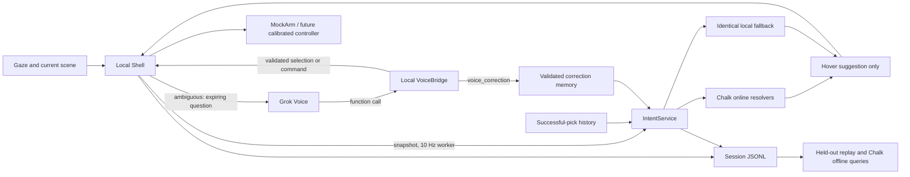

# Look: gaze, Grok Voice and Chalk contracts

The intent layer works against `MockArm` until the calibration/controller backend
is ready. Table positions are millimetres; timestamps are seconds on one session
monotonic clock. The current executable always uses MockArm.

## Controller boundary

`Shell.scene(objects,t)` accepts unique stable object IDs. Scene changes over
10 mm, ID changes, and class changes invalidate pending voice questions. Smaller
jitter is ignored relative to the last accepted scene. `sample(t,x,y,valid)`
receives every eye frame. Tracking loss and gaps over 120 ms break dwell.
A 0.8 s look within 40 mm authorizes a pick; ambiguous gaze asks a question.
A pending question suspends automatic confirmation. The worker targets 10 Hz;
a slow query can reduce the achieved rate. Source/latency are exposed in status.

The arm adapter implements `request_prehover(id)`, `cancel_prehover()`,
`grasp(id)`, `stop()`, `release(id)` and `put_back(id,x,y)`.
Pre-hover never authorizes descent. The real controller must independently
validate calibration, reach, collision/no-go zones, speed, authorization and
current scene. Adapter calls must enqueue and return promptly.

`grasp_ok`, `delivered` and `released` are actual outcome callbacks. Dispatch
is not success. Held state clears only on a release callback. Successful-grasp
memory records the original confirmed scene position, not a later detection.
The shell emits mock `arm_descend` at dispatch; production adapters must emit it
at physical descent with the same authorization task ID. The audit expires
single-use authorization after 2 s; adapt it explicitly to real controller timing.

## Grok boundary

`VoiceBridge` exposes select, shift, cancel, release, put_back and repeat_last.
Tool arguments contain IDs/directions, never servo angles. Unknown arguments,
missing candidates, stale scene versions, expired questions, busy tasks and
invalid return locations are refused with speakable reasons. Calls are
idempotent by (question_id, call_id); one accepted action closes the question.
Shift chooses a candidate, not a Cartesian motor jog. The user is at table y=0.

`GrokVoice` implements the direct xAI WebSocket function-call protocol. It waits
for session acknowledgement, speaks the question, and opens the mic for the
answer. Mic input is off outside the question and during assistant audio.
Tools are rejected until a user-audio commit is observed. Parallel calls get
all their outputs before one continuation at response.done. A session expires
in 15 s; errors close audio and the question. No raw audio/transcript is logged.

Because the mic is question-gated, there is no always-listening voice stop.
Use the hardware stop in the physical prototype. The pipeline may open a new
question through request_voice() for a pending held-object action.

## Correction-to-Chalk boundary

An explicit correction records event_id, query_id, previous_cls, wrong_id,
wrong_cls, correct_id and correct_cls. The previous class comes from successful
picks. It is not supplied by the model. Feedback is user-scoped and persisted
separately from picks; duplicate events do not add evidence twice.

The next online request sends history_json, corrections_json and params_json.
The graph computes gaze_shares, transition_prior and decision with the same
scoring functions as local fallback. Corrected choices add labelled transition
observations to the smoothed habit counts. They never fabricate successful picks
or remove minimum gaze evidence. This is count-based adaptation, not LLM training.
Successful transitions and explicit corrections are distinct evidence sources;
a corrected task that later succeeds can contribute to both. Evaluate whether
this weighting helps on real held-out sessions before claiming improvement.

Chalk owns feature computation, not actuator permission. Failure or >150 ms
waiting switches to local scoring and a five-second circuit breaker. Only one
unfinished cloud query is allowed; SDK connect/request timeouts are also set.
AI Gateway is not used: Grok connects directly to xAI.

## Evaluation boundary

Replay reconstructs history and feedback using only events available by each
tick, including session-start memory snapshots. Tune each ablation on train
sessions only. Both online and offline requests pass explicit validated Params,
so gaze-only (beta=0) and habits actually use distinct deployed configurations.
Corrections count as wrong guesses even if an earlier fixation matched the
wrong object. Report correction cases, predicted coverage/lead, false pre-hover,
top-1 before confirmation, source/latency and unauthorized descents.

Train/test paths and exact file contents must be disjoint. Test-time adaptation
is prequential: earlier test corrections can affect later predictions, never
earlier ones. Synthetic fixtures are labelled and cannot substantiate user
benefit, physical speed gains, or hardware safety. Session memory snapshots must
be captured at session start, not reconstructed from the user's final memory.

## Provider references and validation

- xAI: https://docs.x.ai/developers/model-capabilities/audio/speech-to-speech
- Chalk offline queries: https://docs.chalk.ai/docs/query-offline
- Cursor rules: https://cursor.com/docs/rules

Local resolver and request-contract checks use chalkpy 2.163.1. A real deployment,
API credentials, audio device and physical arm must still be checked on-site.
The Cursor rule makes these contracts available; it is not proof of Cursor use.
